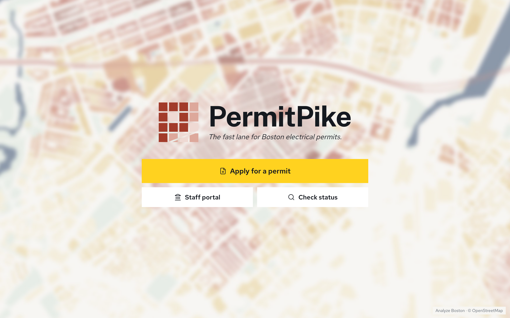
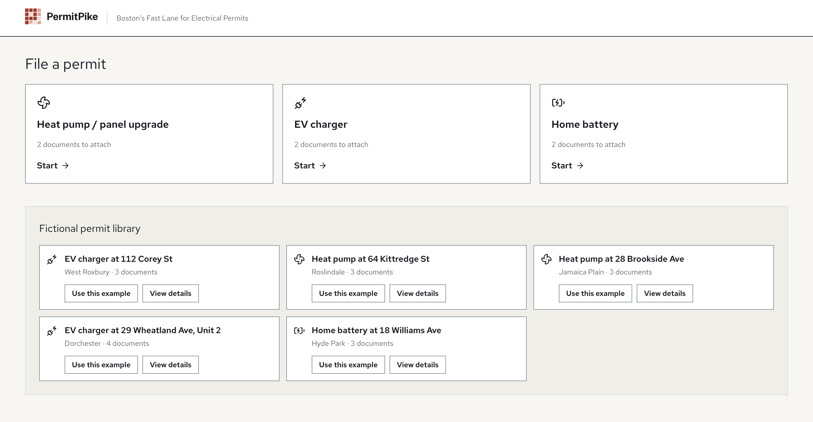
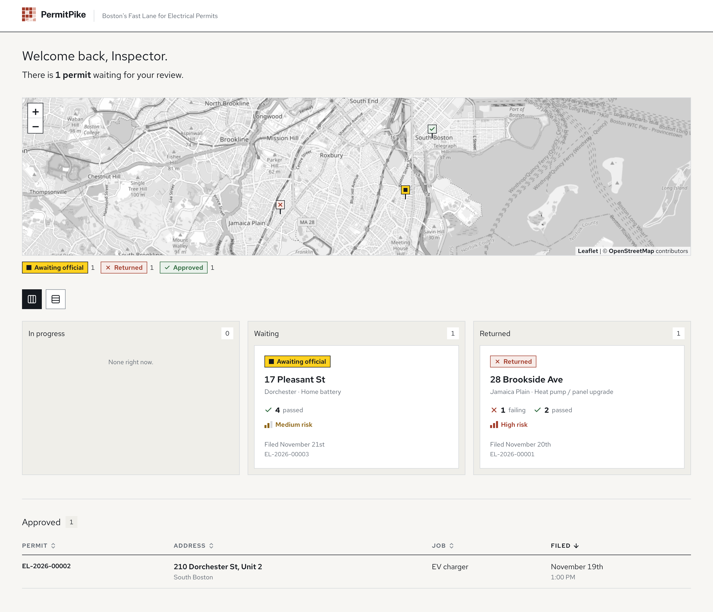
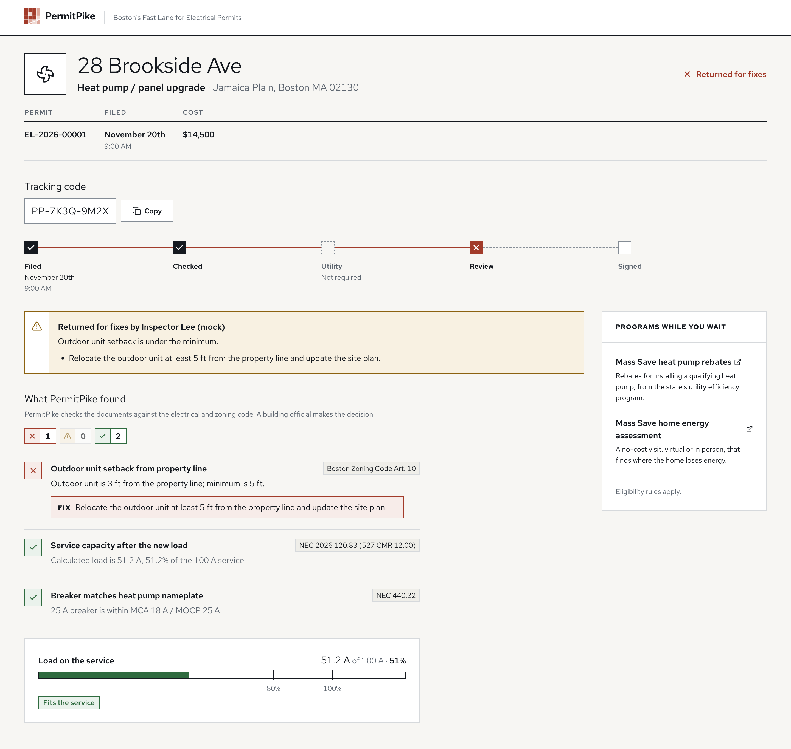
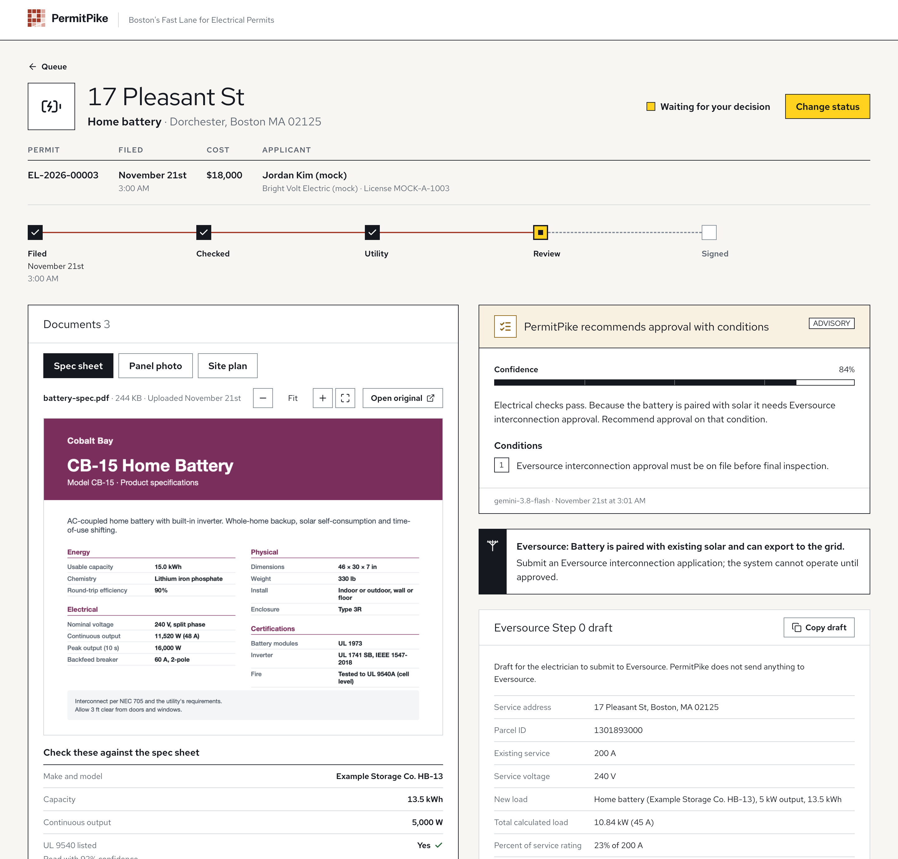
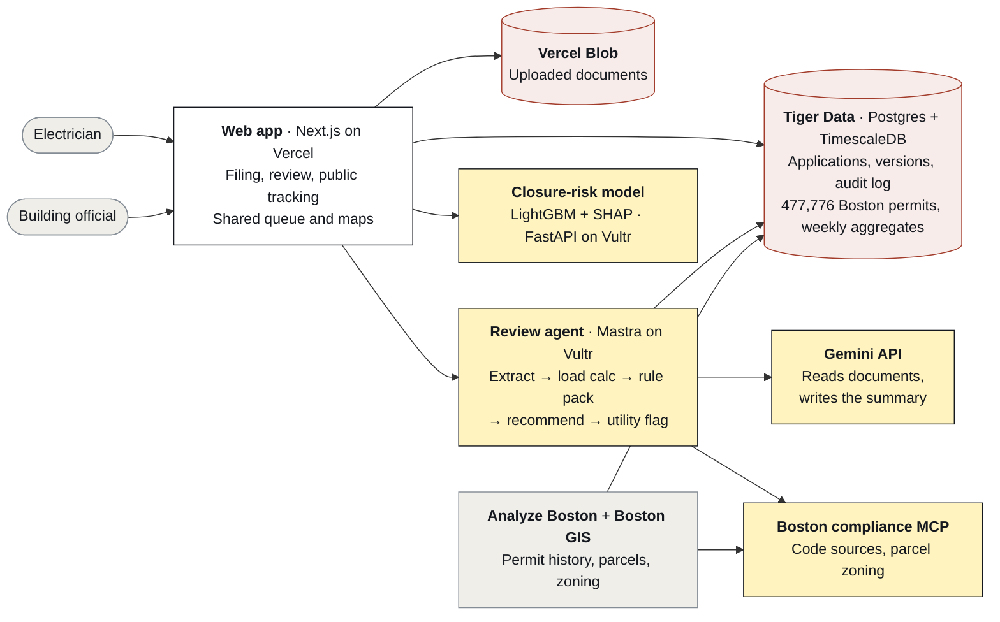
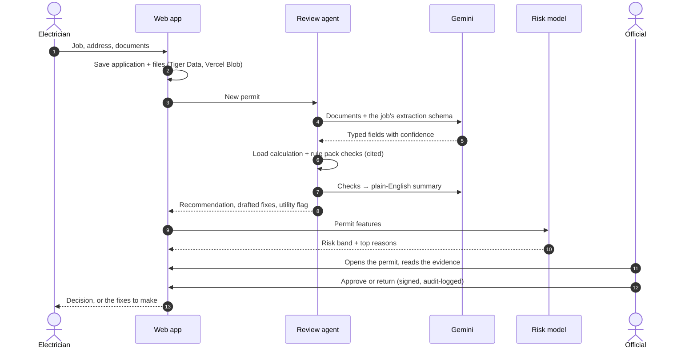

<p align="center">
  <picture>
    <source media="(prefers-color-scheme: dark)" srcset="docs/permitpike-logo-dark.png">
    
  </picture>
  &nbsp;&nbsp;&nbsp;&nbsp;&nbsp;&nbsp;&nbsp;&nbsp;
  <picture>
    <source media="(prefers-color-scheme: dark)" srcset="docs/bostonhacks-logo-dark.png">
    
  </picture>
</p>

<h1 align="center">PermitPike is Boston's fast lane for electrical permits</h1>

<p align="center">
  <b>Built for BostonHacks 2026</b> · Boundless Boston track
</p>

<p align="center">
  <a href="https://permitpike.vercel.app"></a>
  
  
  
  
</p>

<p align="center">
  
</p>

Every heat pump, EV charger and home battery in Massachusetts needs an electrical permit, and
Boston alone issues **about 40,000 permits a year**. **The clean energy transition is waiting in
that line:** one missing number puts a file on hold, and a family waits another week for power
it has already paid for.

**PermitPike reviews the file the moment it's filed.** It reads the electrician's documents,
runs the code checks and the load calculation, and puts a **cited recommendation** in front of
the city reviewer, who confirms it and signs off. **We also trained our own model**, a LightGBM
classifier on 477,776 Boston permits, that flags which applications are likely to stall and
says why, so reviewers can catch them early. We're building a world where a complete permit
is approved the same week it's filed.

<table>
  <tr>
    <td align="center" width="25%"><h2>40,000</h2>permits a year from Boston ISD<sup>1</sup></td>
    <td align="center" width="25%"><h2>477,776</h2>Boston permits our closure-risk model trained on<sup>2</sup></td>
    <td align="center" width="25%"><h2>55%</h2>of eligible Boston permits since 2015 never marked closed<sup>3</sup></td>
    <td align="center" width="25%"><h2>&lt; 1 min</h2>from filing to a cited recommendation in the queue</td>
  </tr>
</table>

<sub>
1. <a href="https://content.boston.gov/node/16047426">City of Boston</a>.
2. Analyze Boston building permits, 2015 to November 2026; test ROC AUC 0.759 (<a href="ml/README.md">model card</a>).
3. 252,478 of 457,253 eligible permits issued 2015 on, Analyze Boston snapshot of November 21st, 2026 (<a href="ml/README.md">model card</a>).
</sub>

---

## Two sides of one permit

PermitPike is one app with two doors. Electricians file and fix; officials review and decide.
Both see the same permit move along the same trail, from filed to signed.

<table>
  <tr>
    <th width="50%">The electrician</th>
    <th width="50%">The building official</th>
  </tr>
  <tr>
    <td></td>
    <td></td>
  </tr>
  <tr>
    <td valign="top">
      <b>File in minutes.</b> Pick the job (heat pump or panel upgrade, EV charger, home battery),
      confirm the property on a map of the parcel, and attach one document per row. The permit
      gets a tracking code (<code>PP-XXXX-XXXX</code>) and lands straight in the city's queue.
    </td>
    <td valign="top">
      <b>One shared queue.</b> A board (In progress, Waiting, Returned) or a table, sorted by
      closure risk, with every open permit pinned on a map of Boston. Pin heads use the same
      mark shapes as the status chips, so status never depends on color alone.
    </td>
  </tr>
  <tr>
    <td></td>
    <td></td>
  </tr>
  <tr>
    <td valign="top">
      <b>Know exactly what to fix.</b> A returned permit shows the official's reason, each failing
      check with its code citation and a plain-words fix, and the load on the service. Upload
      the corrected documents and resubmit; the official sees only what changed.
    </td>
    <td valign="top">
      <b>Documents first.</b> The workspace opens on the applicant's actual files, with zoom, and
      under each one the values to check against it. Anything read with under 85% confidence
      is flagged to read from the document. "Change status" approves or returns; overriding a
      failing check needs a written reason, and every action is signed into an audit log.
    </td>
  </tr>
</table>

Anyone with a tracking code can check a permit at `/track` without signing in. The public page
shows the status and next steps, never the AI recommendation, plus the Mass Save and utility
programs that fit the job.

## Stack

| | |
| --- | --- |
| **AI** | Gemini API, Mastra (agent, workflow, MCP server), Model Context Protocol |
| **ML** | LightGBM, SHAP, scikit-learn, pandas, FastAPI |
| **Data** | Tiger Data (Postgres + TimescaleDB), Drizzle ORM, Analyze Boston, Boston ArcGIS |
| **App** | TypeScript, Node.js 22, Next.js 15, React 19, Tailwind CSS 4, Zod, SWR, Leaflet, OpenStreetMap |
| **Hosting** | Vercel (web and Blob storage), Vultr (agent and model API) |

## Features

- **Gemini document reader.** Spec sheets, panel photos and site plans become structured,
  typed fields (breaker sizes, nameplate amps, MCA and MOCP, setbacks), each with its own
  confidence. The electrician confirms every value before filing; nothing is filled in
  silently.
- **A rule pack per device.** Deterministic code checks, failures first, each returning pass,
  warn or fail with a code citation, a link to the published source and a suggested fix.
- **Load calculation you can audit.** Every line with its volt-amps and code section, the
  totals, and a meter against the service with 80% and 100% marks, before and after an upgrade.
- **Utility flag.** When a job needs the utility (a service upgrade, a battery that can export),
  the recommendation says so, so the Eversource request goes in early.
- **Boston compliance MCP.** The same read-only tools the agent uses, served over the Model
  Context Protocol: search official Massachusetts and Boston sources, pull live excerpts with
  page numbers, and resolve any Boston address to its parcel and zoning.
- **Closure-risk model.** LightGBM trained on 477,776 Boston permits predicts which permits are
  likely to stall, with up to three plain-English reasons from SHAP. It sorts the queue; it
  never touches the recommendation.
- **Permit archive.** Reviewers search public Analyze Boston permit records for an address by
  chat, compare past work and open the City's original scans.
- **The Freedom Trail.** Every permit's progress is a solid brick-red line from Filed to Signed,
  the same trail on both sides of the app.
- **Human in the loop, by construction.** The AI's output always reads "PermitPike recommends",
  is marked Advisory and is written in ink, never in a verdict color. Only a reviewer action
  from a signed-in official can approve or return a permit.

## How it works



### What happens when a permit is filed



## Under the hood

| | |
| ---: | --- |
| **3** | job types: heat pump with panel work, EV charger, home battery |
| **17** | deterministic code checks across the three rule packs, every one cited |
| **11** | official Massachusetts and Boston sources in the compliance catalog |
| **3** | MCP tools: code search, live code excerpts, parcel and zoning lookup |
| **477,776** | Boston permits (2015 to November 2026) in a TimescaleDB hypertable |
| **0.759** | test ROC AUC for closure risk, against 0.733 for logistic regression |
| **< 10 ms** | to score one permit (7.8 to 9.5 ms, warmed, on the FastAPI service) |
| **38** | rule pack and load calculation tests, all passing |

### Gemini document reader (`agent/extract`)

The agent sends each upload to the Gemini API (`gemini-3.8-flash`) with the job's extraction
schema, and gets back typed fields plus a confidence for each one. Schemas live in the shared
Zod contract, so the same shape is validated by the agent, the database and the filing form.
Values under 85% confidence, or not found, are never guessed: the electrician confirms them
when filing, and the official sees them flagged in brass with a sentence telling them to read
the value from the document. Gemini also turns the finished checks into the short
recommendation summary. It never decides a check.

### Review agent (`agent/`)

A Mastra server exposes one `POST /review` route, and each request runs a typed three-step
workflow (`review-application`):

1. **`extract`** calls the Gemini extractor with the job's schema.
2. **`run-checks`** loads the job's rule pack and runs the shared load calculation
   (`packages/loadcalc`), which adds the new load to the home's existing load with the NEC
   optional method for dwellings and compares it with the service rating at 80% and 100%.
3. **`recommend`** turns the results into approve, approve with conditions, or return for fixes,
   with drafted fixes, an inspector checklist and an Eversource flag when the job needs more
   service. Only then does the `permit-reviewer` Mastra agent, with the compliance tools
   attached, write the plain-English summary. The decision itself is plain TypeScript, so the
   same inputs always give the same answer.

Every step's input and output is a Zod schema from the contract, and the agent's response is
parsed against `AgentReviewResponse` before it leaves the server.

### Rule packs (`packs/`)

Each device is one pack: an extraction schema, the load it adds, and its checks. Adding a
device means adding a pack; the load engine and the agent stay the same.

| Pack | Checks | What it checks |
| --- | ---: | --- |
| Heat pump / panel upgrade | 8 | Breaker matches nameplate, outdoor unit setback, disconnect within sight, GFCI, conductor ampacity vs MCA, breaker space, working clearance, upgraded panel matches service |
| EV charger | 5 | Breaker sized for continuous load, conductor size, GFCI, outdoor rating, pedestal location |
| Home battery | 4 | UL 9540 listing, backfeed breaker within the busbar 120% rule, install location and clearance to openings, breaker space |

Every check cites its source (NEC article, 527 CMR or Boston Zoning Code), and the citation
links to a reviewed catalog of official sources in `packages/compliance`. The NEC is NFPA's
copyright, so PermitPike stores section numbers and links, never code text.

### Boston compliance MCP (`packages/compliance`)

The review agent and a standalone MCP server share three read-only tools:

| Tool | Input | Returns |
| --- | --- | --- |
| `search_compliance_sources` | Optional `jobType` and `query` | Catalog matches with source IDs, citations, jurisdiction and authority type |
| `get_compliance_source` | `sourceId`, optional `query` (a phrase or section number) | Live excerpts from the publisher's HTML or PDF, with PDF page numbers |
| `resolve_parcel_zoning` | Boston `street` and optional `zip`, or a 10-digit `parcelId` | Parcel, zoning district and subdistrict, overlays, and code and dimensional-table links, from Boston's ArcGIS services |

<details>
<summary>Use it from any MCP client</summary>

Install the workspace dependencies (Node 22.13+ for Mastra), then:

```json
{
  "mcpServers": {
    "permitpike-compliance": {
      "command": "pnpm",
      "args": ["--dir", "/absolute/path/to/PermitPike/packages/compliance", "--silent", "start"]
    }
  }
}
```

Try `search_compliance_sources` with `{"jobType":"ev_charger","query":"EVSE"}`, then
`get_compliance_source` with `{"sourceId":"boston-evse-installation-guide","query":"electrical permit"}`,
or `resolve_parcel_zoning` with `{"street":"300 Washington Street","zip":"02121"}`. Catalog
search works offline; excerpts need outbound HTTPS. The server has no permit decision actions.

</details>

### Closure-risk model (`ml/`)

A LightGBM classifier trained on Analyze Boston's approved building permits predicts whether a
permit will stall before it is closed out. The split is by issue date so the model never sees the
future: training through 2022, validation on 2023 (38,519 permits) and test on the first half
of 2024 (18,888 permits).

| Model | Test ROC AUC | Test PR AUC | Lift in top 10% |
| --- | ---: | ---: | ---: |
| Logistic regression (baseline) | 0.733 | 0.718 | 1.73× |
| **LightGBM** | **0.759** | **0.760** | **1.86×** |

Features are work and permit type, occupancy, ZIP, declared valuation, fees, timing, nine
keyword flags (heat pump, EV, panel, 200 amp, battery, solar and more), up to 500 TF-IDF
description terms, and the applicant's closure rate on strictly earlier permits. The applicant's
name is never a feature. A FastAPI service returns a band (low below ⅓, medium below ⅔, high
above) with up to three SHAP reasons in plain English, in 7.8 to 9.5 ms per warmed request. The
web app calls it with a 2-second timeout; if it's slow or down, review carries on without a score. It predicts paperwork closure, not safety or compliance, and
it never affects the recommendation. Full model card: [`ml/README.md`](ml/README.md).

### Tiger Data (`packages/db`)

One Postgres + TimescaleDB database holds everything: applicants, applications, every version
and an append-only `reviewer_actions` audit log, plus `boston_permits`, a hypertable of 477,776
permits on `issued_date`, and `permits_weekly`, a continuous aggregate of weekly counts by work
type and ZIP, refreshed hourly. `contractor_stats` keeps each contractor's earlier closure rate
for the risk model.

### Front end (`web/`)

Next.js 15 and React on Vercel, with API routes for filing, review and tracking. Browsers upload
documents straight to Vercel Blob with short-lived tokens. Every request and response is
validated against the shared Zod contract (`packages/contract/index.ts`), the single source of
truth for web, agent, packs and database. Maps are Leaflet over grayscale OpenStreetMap tiles
with parcel outlines from Boston GIS; the scroll wheel zooms the map while the page stays still.

## Design: Boston permit office, made modern

Official, calm and precise, with some civic pride and one lively color. It should feel like a
well-designed city form, not a startup site, and it draws on Boston's buildings and streets,
not its brands.

| Boston | Becomes |
| --- | --- |
| City Hall brutalism | Strong rectangles, 1px borders, a visible grid, square corners everywhere |
| Breaker panels, city lots, the Mass Pike | The logo: a 4×4 brick grid with a blocky P and the Pike cut through it |
| State House dome | Dome gold, the one lively color: primary buttons and the current trail stop |
| Back Bay brick | Brick red for failures, returns and the trail path |
| The Freedom Trail | The timeline: a solid brick-red line from Filed to Signed |
| Triple-deckers, brownstones, gas lamps | Line drawings for empty states and the role choice |

- **The homepage** is a blurred heat map of Boston's residential electrical permits that drifts
  on a fresh loop around the city every visit, Allston to the North End. The corner names the
  neighborhood under the middle of the screen with its real permit counts by year.
- **Type** is Red Hat Text with even-width figures, so permit numbers and amps line up. Headings
  are regular weight; size carries the hierarchy. Dates are written in words ("November 21st").
- **Accessible by default:** WCAG AA contrast, visible labels on every input, native `<dialog>`,
  arrow-key tabs, and status that never relies on color: every state has its own mark shape.
- **Motion** is one authored moment (the trail lays itself, stop by stop) and all of it respects
  reduced motion. The full system lives in [`DESIGN.md`](DESIGN.md) and at `/design`.

## Repository

| Path | What |
| --- | --- |
| `web/` | Next.js app and API routes |
| `agent/` | Mastra review agent and workflow |
| `packages/contract/` | Zod schemas and types shared by everything. Start here. |
| `packages/compliance/` | Source catalog, parcel zoning lookup, MCP server |
| `packages/loadcalc/` | Shared load calculation |
| `packages/db/` | Drizzle schema and migrations |
| `packs/` | Rule packs, one per job type |
| `ml/` | Closure-risk model: training, scoring API, Dockerfile |

## Run it

Needs Node 20.12+ and pnpm (`corepack enable`).

```bash
pnpm install
```

```bash
cp .env.example .env
```

Fill in `.env` (every key is described in `.env.example`): the web app needs `DATABASE_URL`,
uploads need `BLOB_READ_WRITE_TOKEN`, and the agent needs `GOOGLE_GENERATIVE_AI_API_KEY`.

```bash
pnpm db:migrate && pnpm seed
```

```bash
pnpm dev:web
```

```bash
pnpm dev:agent
```

The web app runs on http://localhost:3000 and the Mastra dev server on http://localhost:4111
(set `AGENT_URL=http://localhost:4111`). For the risk model, see [`ml/README.md`](ml/README.md)
and set `RISK_API_URL=http://localhost:8000`.

<details>
<summary>Commands, API and deploy</summary>

| Command | Does |
| --- | --- |
| `pnpm check` | Typecheck every package and build web |
| `pnpm db:generate` | Generate a migration after editing `packages/db/schema.ts` |
| `pnpm db:migrate` | Apply migrations to `DATABASE_URL` |
| `pnpm db:check` | Row counts per table and the newest `permits_weekly` rows |
| `pnpm seed` | Load the demo applications |

All request and response shapes live in `packages/contract/index.ts` (`API_ROUTES`):
`POST /api/applicants`, `POST /api/reviewer/session`, `POST /api/blob`, `GET /api/parcel`,
`POST /api/applications`, `GET /api/applications`, `GET /api/applications/:id`,
`POST /api/applications/:id/resubmit`, `POST /api/applications/:id/review`,
`GET /api/track/:code`.

- **Web:** Vercel project with root directory `web` and the env vars from `.env.example`,
  including `AGENT_URL` and `RISK_API_URL`.
- **Agent:** `pnpm --filter @permitpike/agent build`, then `node .mastra/output/index.mjs` on Vultr.
- **Risk model:** `docker build -f ml/Dockerfile -t permitpike-closure-risk .`, then run it on
  Vultr on port 8000.

The hypertable and continuous aggregate are a hand-written migration, because Drizzle doesn't
know hypertables. Never edit an applied migration; add a new one.

</details>

## Data

- Boston permit records come from [Analyze Boston](https://data.boston.gov) (public domain);
  parcels and zoning from the City's ArcGIS services; map tiles © OpenStreetMap contributors.
- Code citations point to official Massachusetts and Boston publications, as section numbers and
  links only.
