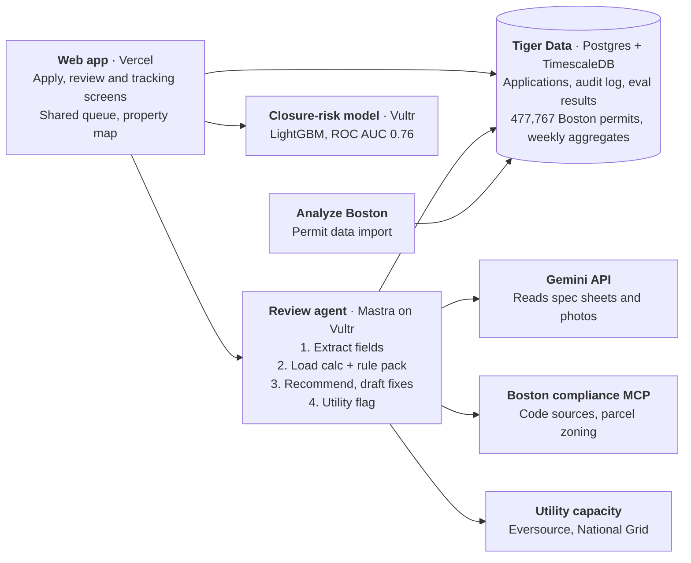

<h1>
  
</h1>

**PermitPike is Boston's fast lane for electrical permits.**

An AI permit desk for residential electrical work in Boston: heat pumps, panel upgrades,
EV chargers and home batteries. An electrician files a permit with a spec sheet and a
photo of the panel. PermitPike reads the documents, runs a load calculation and a set of
code checks for that device, and posts a **recommendation** (approve, approve with
conditions, or return for fixes) with a code citation on every check. A licensed city
official reviews the evidence and makes the decision.

The AI only recommends. Only a human official can approve or return a permit.

Built at BostonHacks 2026 for the Boundless Boston track.

## Why

Every heat pump, EV charger and battery in a Boston home plugs into the same electrical
panel, and each one needs an electrical permit first. The city receives more than 100,000
permit applications a year. Once an electrician submits, they can't change anything until
a reviewer opens it, so one missing document costs a full round trip. Massachusetts needs
roughly 73,000 heat pump installs a year through 2030 to meet its goal, and every one is
another permit in the queue.

PermitPike does the first pass of review the moment a permit is filed, so the official
starts from the evidence and a recommendation instead of a blank application.

## How it works



### The electrician's side (`/apply`)

1. Pick the job: heat pump or panel upgrade, EV charger, or home battery.
2. Enter the address. PermitPike looks up the Boston parcel and asks "Is this the
   property?" with a map of the lot.
3. Attach the documents the job needs, one row each: spec sheet and panel photo are
   required; site plan, load calculation and anything else are optional.
4. File. The permit gets a tracking code (`PP-XXXX-XXXX`) and goes straight into the
   review queue.
5. If the official returns it, the electrician sees the reason and the requested fixes,
   uploads corrected documents and resubmits. The official sees only what changed.

Anyone with the tracking code can check status at `/track`, without signing in. The public
page shows status and next steps, never the AI recommendation, plus the Mass Save and
utility programs that match the job.

### The official's side (`/review`)

1. One shared queue on every device, as a board (In progress, Waiting, Returned) or a
   table, sorted by risk, with a map of every open permit. Approved permits sit apart.
2. Each permit opens on the documents themselves, with zoom, and next to each document
   the values to check against it. Low-confidence values are marked so the official reads
   them from the file.
3. Evidence tabs: Checks (failures first, each with its citation and a link to the source
   document), Permit record, Load calculation, Inspection, History.
4. "Change status" offers Approve or Return for fixes, with PermitPike's recommendation
   marked. Approving against a failing check is an override and needs a written reason.
   Every action is signed with the official's name and kept in an append-only audit log.

### What happens when a permit is filed

1. **Save.** The web API stores the application and its files (Vercel Blob) in Tiger Data.
2. **Extract.** The agent sends the uploads to Gemini with the job's extraction schema and
   gets structured fields back: breaker sizes, nameplate amps, MCA and MOCP, setbacks.
3. **Load calculation.** The shared load engine (`packages/loadcalc`) adds the new
   device's load to the home's existing load and compares the total with the service
   rating, using the NEC optional method for dwellings.
4. **Rule pack.** The job's rule pack runs its checks. Each check returns pass, fail or
   warn, with a code citation and a suggested fix.
5. **Recommend.** The agent turns the checks into a decision, drafts the fixes for the
   electrician and writes a short plain-English summary.
6. **Utility flag.** If the load needs a service upgrade, the recommendation says so and
   tells the electrician to open an Eversource service request before installing.
7. **Closure risk.** The web app scores the permit with the closure-risk model and shows
   the band and its top reasons to the official.

### Rule packs

Each device is one pack in `packs/`: an extraction schema, the load it adds, and its
checks. Adding a device means adding a pack; the load engine and the agent stay the same.

| Pack | Checks |
| --- | --- |
| Heat pump / panel upgrade | Breaker matches nameplate, outdoor unit setback, disconnect within sight, GFCI, conductor ampacity vs MCA, breaker space, working clearance, upgraded panel matches service |
| EV charger | Breaker sized for continuous load, conductor size, GFCI, outdoor rating, pedestal location |
| Home battery | UL 9540 listing, backfeed breaker within the busbar 120% rule, install location and clearance to openings, breaker space |

Every check cites its source (NEC article, 527 CMR, or Boston Zoning Code). Citations link
to a reviewed catalog of official Massachusetts and Boston sources in
`packages/compliance`, so a reviewer can open the code behind any check.

### Closure-risk model

A LightGBM model trained on 477,767 Boston permits from Analyze Boston predicts how likely
a permit is to stall before it is closed out. On held-out test data it reaches ROC AUC
0.76, and the top 10% of scores are 1.86 times more likely to stall than average. It
returns a low, medium or high band with up to three plain-English reasons (SHAP), and runs
as a small FastAPI service on Vultr (`ml/`). It predicts paperwork closure, not safety or
compliance, and it never affects the recommendation.

### Evals

`evals/cases` holds labeled applications with the expected decision and per-check
results. `pnpm evals` runs every case through the same pipeline and reports decision
accuracy, accuracy per rule and dangerous misses (a failing check scored as a pass), and
writes each run to `eval_runs` in Tiger Data for the eval dashboard at `/review/evals`.

### Boston permit archive

Open **Archive** from the reviewer header or **Search permit archive** from a permit.
The chat searches public Analyze Boston permit records by address, neighborhood, type
of work, year, or permit number. Reviewers can compare records, download summaries,
open official reference PDFs, and look up original scans in the City’s ScerIS archive.
On the web host, `GOOGLE_GENERATIVE_AI_API_KEY` enables optional Gemini assistance
when the shared database rate limiter is available. Searches use the same public
sources when Gemini is unavailable.

## Stack

| Tool | What it does in PermitPike |
| --- | --- |
| **Gemini API** | Reads uploaded spec sheets and panel photos into structured fields, and writes the recommendation summary |
| **Mastra** | Runs the review agent and workflow (extract, check, recommend), and serves the Boston compliance MCP tools |
| **Tiger Data** | The one shared database: applications, versions, audit log and eval runs, plus a hypertable of Boston permit history with continuous weekly aggregates |
| **Vultr** | Hosts the Mastra agent and the closure-risk model API |
| **Vercel** | Hosts the Next.js web app and stores uploads in Vercel Blob |
| **Analyze Boston** | Public Boston permit records for the closure-risk model and permit history |
| **OpenStreetMap + Boston GIS** | Parcel outlines, zoning layers and the map tiles |

Everything is TypeScript except the model service (Python). Shapes shared between the web
app, agent, packs, database and evals live in one Zod contract,
`packages/contract/index.ts`.

## Layout

| Path | What |
| --- | --- |
| `web/` | Next.js 15 app and API routes (Vercel) |
| `agent/` | Mastra review agent and workflow (Vultr) |
| `packages/contract/` | Zod schemas and types shared by everything. Start here. |
| `packages/compliance/` | Boston and Massachusetts source catalog, parcel zoning lookup, Mastra MCP server |
| `packages/loadcalc/` | Shared load calculation: existing plus added load vs service rating |
| `packages/db/` | Drizzle schema and migrations for Tiger Data |
| `packs/` | Rule packs, one per job type |
| `ml/` | Closure-risk model: training, scoring API, Dockerfile |
| `evals/` | Labeled cases and the eval runner |
| `data/` | Boston permits seed data (not committed) |

## Setup

Needs Node 20.12+ and pnpm (`corepack enable`).

```bash
pnpm install
```

```bash
cp .env.example .env
```

Fill in `.env` (every key is described in `.env.example`). The web app needs
`DATABASE_URL`; uploads need `BLOB_READ_WRITE_TOKEN`; the agent needs
`GOOGLE_GENERATIVE_AI_API_KEY`.

First time against a new database:

```bash
pnpm db:migrate && pnpm seed
```

`pnpm seed` loads three demo applications into the queue (rerun it to reset the demo).

```bash
pnpm dev:web
```

Open http://localhost:3000.

```bash
pnpm dev:agent
```

Mastra dev server on http://localhost:4111. Set `AGENT_URL=http://localhost:4111` so the
web app sends new permits to it.

To run the closure-risk model locally, see `ml/README.md`, then set
`RISK_API_URL=http://localhost:8000`.

## Commands

| Command | Does |
| --- | --- |
| `pnpm check` | Typecheck every package and build web |
| `pnpm db:generate` | Generate a migration after editing `packages/db/schema.ts` |
| `pnpm db:migrate` | Apply migrations to `DATABASE_URL` |
| `pnpm db:check` | Row counts per table and the newest `permits_weekly` rows |
| `pnpm seed` | Load the demo applications |
| `pnpm evals` | Validate and run the eval cases |

## Database

Tiger Data (Postgres + TimescaleDB). Everything reads `DATABASE_URL` from the root `.env`
(Tiger's connection string, `sslmode=require`). `.env` is gitignored.

- `applicants`, `applications`, `application_versions`, `reviewer_actions` (append-only
  audit log) and `eval_runs` come from `packages/db/schema.ts`.
- `boston_permits` is a hypertable on `issued_date`, segmented by `worktype`.
- `permits_weekly` is a continuous aggregate of weekly counts by `worktype` and ZIP,
  refreshed hourly.
- `contractor_stats` holds each contractor's earlier closure rate for the risk model.

The hypertable and aggregate are in a hand-written migration, because Drizzle doesn't know
hypertables. After editing `schema.ts`, run `pnpm db:generate`; never edit an applied
migration, add a new one.

## API

All request and response shapes live in `packages/contract/index.ts` (`API_ROUTES`).

- `POST /api/applicants` (name and license number; creates or reuses)
- `POST /api/reviewer/session` (reviewer name; sets the reviewer cookie)
- `POST /api/blob` (upload tokens; browsers upload straight to Vercel Blob)
- `GET /api/parcel` (address to Boston parcel candidates)
- `POST /api/applications`
- `GET /api/applications?status=&jobType=` (reviewer) or `?applicantId=` (My permits)
- `GET /api/applications/:id`
- `POST /api/applications/:id/resubmit`
- `POST /api/applications/:id/review` (official's approve, return or override)
- `GET /api/track/:code` (public status by tracking code)
- `GET /api/evals`

## Boston compliance MCP

The review agent and a local MCP server share these read-only tools.

| Tool | Input | Result |
| --- | --- | --- |
| `search_compliance_sources` | Optional `jobType` (`heat_pump_panel`, `ev_charger`, or `home_battery`) and `query` | Catalog matches with source IDs, citations, jurisdiction and authority type |
| `get_compliance_source` | `sourceId` and optional `query` (an exact phrase or section number) | Live excerpts from the publisher's HTML or PDF, PDF page numbers and retrieval status |
| `resolve_parcel_zoning` | Boston `street` and optional `zip`, or a 10-digit `parcelId` | Parcel, district and subdistrict matches, intersecting overlays, and code and dimensional-table links |

Use this stdio configuration in an MCP client after installing the workspace
dependencies. Set the path to your local checkout and use Node 22.13+ for Mastra.

```json
{
  "mcpServers": {
    "permitpike-compliance": {
      "command": "pnpm",
      "args": [
        "--dir", "/absolute/path/to/PermitPike/packages/compliance",
        "--silent", "start"
      ]
    }
  }
}
```

For example, search with `{"jobType":"ev_charger","query":"EVSE"}`, then retrieve
`{"sourceId":"boston-evse-installation-guide","query":"electrical permit"}`. For parcel
zoning, try `{"street":"300 Washington Street","zip":"02121"}`.

Catalog search works offline; excerpts need outbound HTTPS to the publishers. For a parcel
that spans several zones, use the location of the proposed work and confirm against the
city's signed zoning maps. The MCP supplies references for review and has no permit
decision actions.

## Deploy

- **Web:** Vercel project with root directory `web`. Set the env vars from `.env.example`,
  including `AGENT_URL` and `RISK_API_URL`.
- **Agent:** `pnpm --filter @permitpike/agent build`, then run
  `node .mastra/output/index.mjs` on the Vultr server.
- **Closure-risk model:** `docker build -f ml/Dockerfile -t permitpike-closure-risk .`,
  then run it on the Vultr server on port 8000.

## Data and limits

- Boston permit records come from Analyze Boston (public domain).
- Code citations point to official Massachusetts and Boston publications. The NEC itself
  is copyrighted by NFPA, so PermitPike stores section numbers and links, never code text.
- PermitPike collects no permit fees and doesn't verify electrician licenses against the
  state registry. A city deployment would add both.
